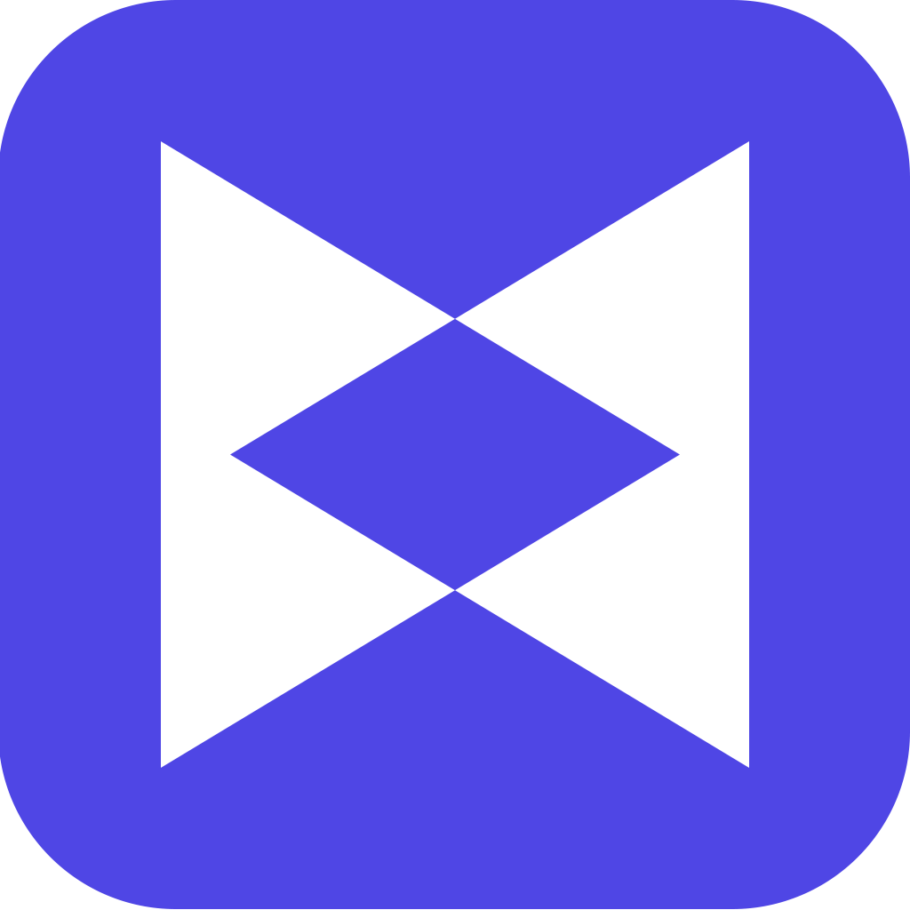
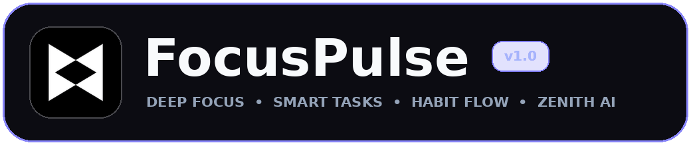
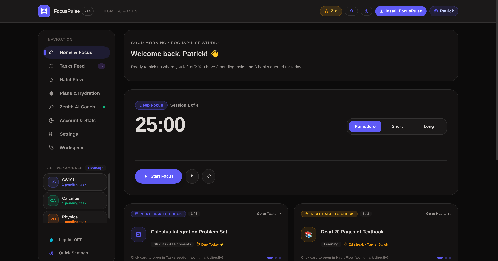
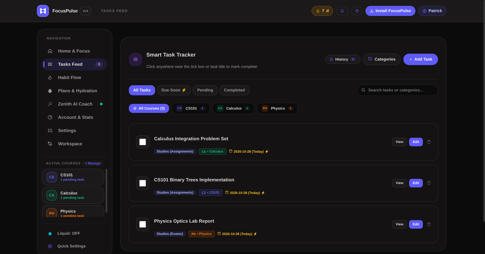
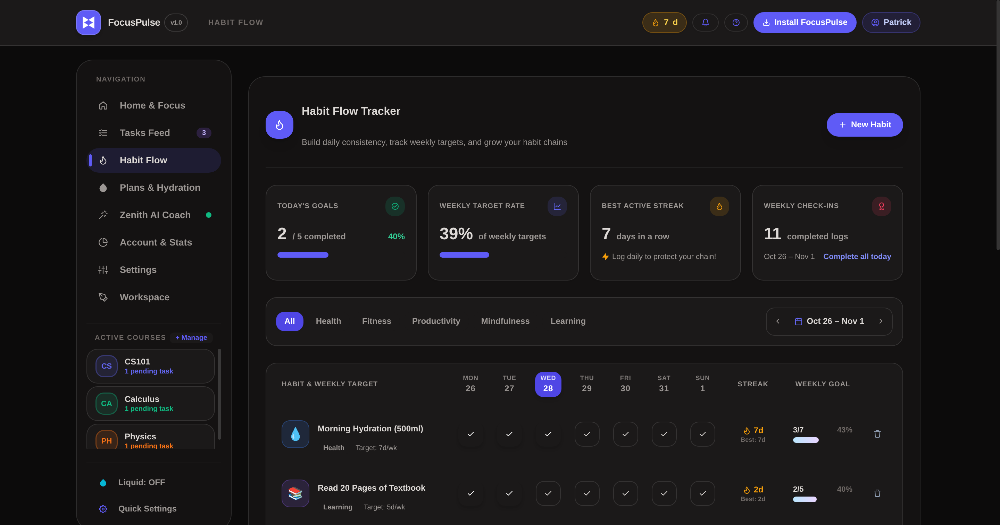
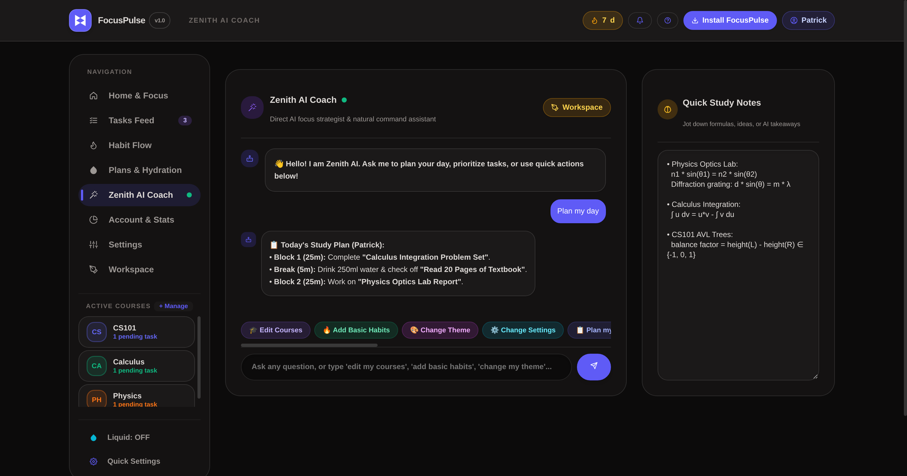
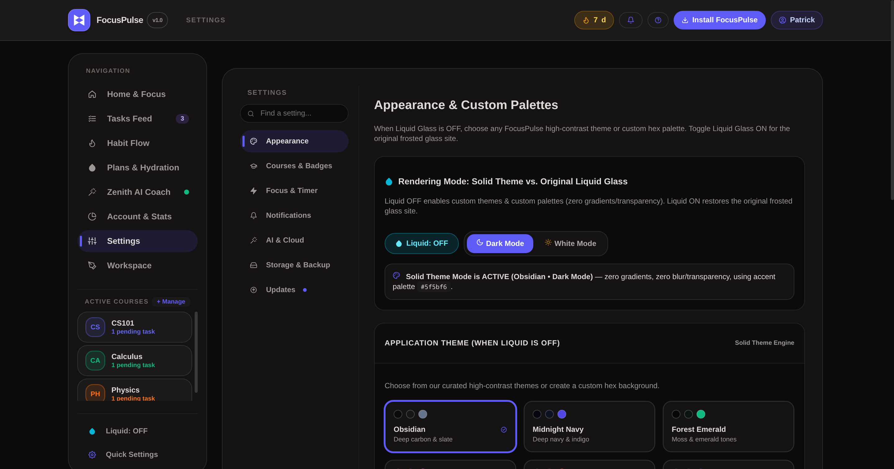
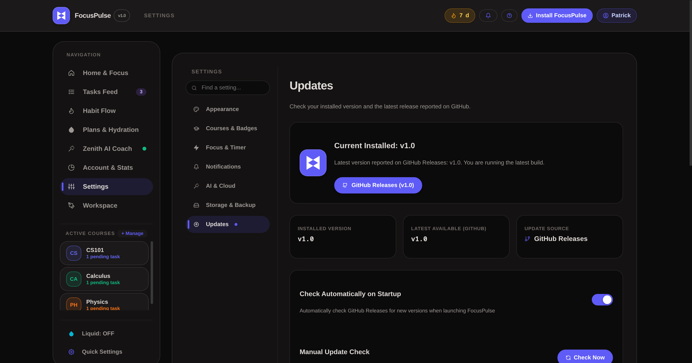
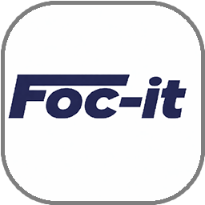
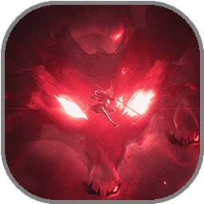

<div align="center">

 

</div>

# ⚡ FocusPulse

<div align="center">



</div>

### 🎯 The deep-work suite you always wanted

🚫 No Ads • 💰 No Subscription • ⚡ Full Control

<div align="center">


<br>


</div>

<br>
<hr>

⚠️ **Official FocusPulse Notice**

This is the official FocusPulse repository, maintained by **[Foc-It](https://github.com/foc-it)**.

Official source code & releases:
https://github.com/foc-it/FocusPulse

Please be cautious of third-party websites or downloads using the FocusPulse name that are not linked from this repository. For your safety, download FocusPulse only from the official GitHub Releases page (`FocusPulse v1.0`).

<hr>
<br>

## 📥 Download & Install FocusPulse (`FocusPulse v1.0`)

<div align="center">

<a href="https://github.com/foc-it/FocusPulse/releases/latest">
  
</a>

</div>

<br>

| Platform | Package / Format | Download & Access Link | Installation Notes |
| :--- | :--- | :--- | :--- |
| 🪟 **Windows 10 / 11 (64-bit)** | NSIS Installer (`FocusPulse_1.0.0_x64-setup.exe`) | [**Download from GitHub Releases**](https://github.com/foc-it/FocusPulse/releases/latest) | Run the `.exe` setup installer. Includes borderless desktop titlebar, single-instance system tray restore, external default browser link launcher, and optional startup launch. |
| 🤖 **Android 7.0+ (Signed APK)** | Universal Signed APK (`FocusPulse_1.0.0_Android_Signed.apk`) | [**Download Signed APK on Releases**](https://github.com/foc-it/FocusPulse/releases/latest) | Download the **signed** `.apk` from GitHub Releases. Features the floating half-transparent iOS bottom navigation dock and device Google Account Chooser. |
| 🌐 **Web Application / PWA** | Hosted Browser & Offline-Ready Web App | [**Launch Web App**](https://foc-it.github.io/FocusPulse/) *(or click **Install FocusPulse** in the web navbar)* | Works in any modern desktop or mobile browser. Click **Install FocusPulse** in the top navigation bar to switch between Web, Windows, or Android anytime. |

---

## 🚀 Why FocusPulse?

FocusPulse is not just another timer — it's a **complete deep-work, academic, and habit suite** crafted for students, developers, and creators.

* ⚡ **Blazing Fast** — includes a zero-blur Eco GPU pipeline for low-spec devices and battery saving
* 🎯 **Built for Students & Power Users** — two-letter course badges, deadline-sorted tasks, and study schedules
* 🔋 **Wall-Clock Resilient** — timer keeps accurate time even when minimized to the system tray or when your phone screen is off
* 🎨 **Dual Visual Engine** — switch effortlessly between **iOS Liquid Glass** and **8 Solid Themes** (Dark & Light surfaces)
* ☁️ **Local-First + Instant Cloud Sync** — works 100% offline in Guest Mode or syncs across devices via Google & Email/Password accounts

> 💡 Your focus, courses, tasks, habits, and hydration — *all in one place*

---

## 📸 Preview

<div align="center">





<br/><br/>





</div>

---

## ✨ Comprehensive Features Overview

### 🎬 1. Animated Startup & Smart First-Launch Experience
- **Every-Launch Animated Lockup:** Smooth, 1.5-second startup intro featuring the official FocusPulse logo and sliding wordmark (respecting `prefers-reduced-motion` and Eco Mode).
- **Smart State Routing:** Automatically routes first-time visitors to the Welcome screen, resumes unfinished onboarding steps, and sends returning users straight to their personalized dashboard.
- **Casual 6-Step Personal Setup:** Friendly, skippable setup for your Name & Profile Picture, Active Courses, First Task, Starter Habits, Hydration & Study Plan, and Sound/Notification channels.

### ⏱️ 2. Smart Pomodoro & Deep Focus Engine
- **Sharp Tabular Typography:** Crisp **Museo Sans 900** tabular numerals that never jitter during countdowns.
- **One-Tap Study Presets:** Switch between *Normal (25/5)*, *Blitz (15/3)*, *Quick Rev (45/10)*, and *Extra+ (60/15)*, or customize Pomodoro, Short Break, and Long Break intervals.
- **Dynamic Accent Synchronization:** Active timer mode buttons (`Pomodoro`, `Short`, `Long`), progress rings, and `DEEP FOCUS` badges dynamically adapt to your chosen Accent Palette.
- **Background & Tray Accuracy:** Uses wall-clock delta tracking (`targetEndTimeMs`) so sessions finish on time even while hidden in the Windows system tray or backgrounded on mobile.

### 📋 3. Smart Task Tracker & Active Course Badges
- **Deadline-Driven Sorting:** Pending tasks automatically sort by remaining days until the due date so urgent coursework stays on top.
- **Custom 2-Letter Course Badges:** Create subjects (*e.g., Mathematics `MA`, Programming `PR`, Physics `PH`*) with custom 2-letter badges and color swatches, filter tasks by course from the sidebar, or assign courses via square selector cards.
- **Category & Subcategory Hierarchy:** Organize tasks across *Studies*, *Fitness*, *Health*, and *Personal* with customizable subcategories.
- **Automatic 24-Hour Task History:** Completed tasks remain visible for 24 hours and then archive automatically into Completed Task History (with 1-click restore anytime).

### 🔥 4. Seven-Day Habit Flow Matrix & Streak Protection
- **Interactive 7-Day Grid:** Track daily check-ins across an intuitive Monday–Sunday matrix with custom emojis, categories, and weekly frequency targets (`3d/wk` to `7d/wk`).
- **Live Habit Analytics:** Monitor Today's Completion Rate, Weekly Target Progress, Daily Completion Bar Charts, and your Streak Leaderboard.
- **Missed Streak Restoration:** Includes a 1-per-week Streak Restore safeguard so a single busy exam day doesn't wipe out your hard-earned momentum.

### 💧 5. Active Study Plans & Smart Hydration Tracker
- **Recurring Study Schedules:** Build weekday and weekend study routines specifying target daily hours, session counts, and active days of the week.
- **Customizable Hydration Engine:** Log water intake with 1-tap cup buttons (`+250ml`, `+500ml`), configure your daily fluid goal (`ml`) and glass size, and set custom reminder intervals (`Every 30m`, `45m`, `60m`, `90m`, or `120m`).

### 🤖 6. Zenith AI Coach & Slide-Out Session Workspace
- **Offline-Ready Academic Coach:** Built-in coaching playbooks for exam prep, procrastination recovery, Pomodoro optimization, and custom study topic breakdowns — working 100% offline.
- **Natural-Language Dashboard Actions:** Tell Zenith AI `add task: Finish Lab Report`, `check habit: Morning Hydration`, `start timer`, `log water`, or `white mode` to control the app directly.
- **Optional Gemini Cloud Key:** Bring your own Google AI Studio key (`AIza...`) in Settings for live cloud LLM responses.
- **Session Workspace & Quick Notes:** Slide-out scratchpad and session checklist for formulas, brain-dumps, and study notes.

### 👤 7. Profile Pictures, Cross-Device Cloud Sync & Guest Backup Guard
- **Custom Profile Pictures & Avatar Presets:** Upload any photo (automatically center-cropped and compressed for fast sync) or choose from 6 built-in avatar badges, displayed across the topbar, mobile floating nav, and Profile dashboard.
- **Platform-Native Google & Email/Password Auth:**
  - **In Mobile App / Web:** Opens a device Google Account Chooser popup to select from Google accounts signed in on your device.
  - **In Windows Desktop EXE:** Opens your default system web browser for secure Google login and prompts you right back to the desktop app upon completion.
- **Automatic Cloud Restore (Zero Repeated Questions):** Signing into an existing Google or Email/Password account automatically fetches and restores your cloud profile, courses, tasks, habits, and settings — skipping all landing/onboarding questions.
- **Smart Guest Data Backup Prompt:** If you already have data in Guest Mode and choose **Sign Up**, your guest data seamlessly syncs into your new account. If you choose **Sign In** to an existing account, FocusPulse warns you before logging in and provides a 1-click **Export Backup (`.json`)** button so you never lose local work.
- **Morphing Auth Button:** The `Sign In / Sign Up` button smoothly morphs into a `Logout` button whenever you are signed in.

### 🎨 8. iOS Liquid Glass, 8 Solid Themes & Adaptive Platform UI
- **Enhanced iOS Liquid Glass Mode:** Multi-layered optical blur (`backdrop-filter: blur(36px) saturate(215%)`), specular top-edge highlights, and ambient mesh gradients.
- **Floating Half-Transparent iOS Bottom Nav (Mobile / App):** In mobile and Android APK views, navigation floats as a half-transparent iOS glass capsule dock with smooth pill highlights.
- **8 Solid Themes + Custom Hex:** *Obsidian*, *Midnight Navy*, *Forest Emerald*, *Cyberpunk*, *Sunset Crimson*, *Pure Black*, *Pure White*, and *Custom Hex*, all supporting both Dark and White surfaces.
- **Desktop System Tray & Single-Instance Wakeup:** Closing the Windows `.exe` minimizes smoothly to the system tray; launching the `.exe` again while in the tray immediately wakes and focuses your existing window.

---

## 🛠️ Setup & Build Instructions

### 1. Prerequisites
- **Node.js** (v18+ recommended) and **npm**
- **Rust & Cargo** (stable toolchain) + **Visual Studio C++ Build Tools** (for Windows `.exe` builds)
- **Android Studio** with Android SDK, NDK, and Build-Tools (for Android `.apk` builds)

### 2. Clone & Install Dependencies
```bash
git clone https://github.com/foc-it/FocusPulse.git
cd FocusPulse
npm install
```

### 3. Run or Build Release Packages (`FocusPulse v1.0`)
- **Start Web Development Server:**
  ```bash
  npm run dev
  ```
- **Build Production Web Bundle (`dist/`):**
  ```bash
  npm run build
  ```
- **Build Windows Desktop Installer (`.exe`):**
  ```bash
  npx tauri build --bundles nsis
  ```
  *Output:* `src-tauri/target/release/bundle/nsis/FocusPulse_1.0.0_x64-setup.exe`
- **Build & Sign Android Installer (`.apk`):**
  ```bash
  npx tauri android build --apk
  powershell -ExecutionPolicy Bypass -File .\Sign_FocusPulse_APK.ps1
  ```
  *Output:* `FocusPulse_1.0.0_Android_Signed.apk`

---

## 🔒 Public Repository & Release Checklist (`FocusPulse v1.0`)

1. **Private Keys & Secrets Excluded:** `.gitignore` automatically excludes `js/config.local.js`, `.env`, `*.jks`, `*.keystore`, `node_modules/`, `dist/`, and `src-tauri/target/`.
2. **Publishing Releases Only (`FocusPulse v1.0`):** Upload your compiled `FocusPulse_1.0.0_x64-setup.exe` and signed `FocusPulse_1.0.0_Android_Signed.apk` directly to **GitHub Releases** tagged `v1.0` (titled `FocusPulse v1.0`) rather than committing binary installers into git history.
3. **Firebase Security Rules:** In Firebase Console → Firestore Database → Rules, ensure authenticated users can only read/write their own documents:
   ```text
   rules_version = '2';
   service cloud.firestore {
     match /databases/{database}/documents {
       match /users/{userId} {
         allow read, write: if request.auth != null && request.auth.uid == userId;
       }
       match /users_by_email/{emailKey} {
         allow read, write: if request.auth != null;
       }
     }
   }
   ```

---

## 💬 Community & Feedback

Have a feature request, found a bug, or want to share your favorite focus setups? Join the FocusPulse community!

* **Email:** [info.focit@gmail.com](mailto:info.focit@gmail.com)
* **GitHub Discussions:** [Open a Discussion](https://github.com/foc-it/FocusPulse/discussions)

---

## 🙌 Credits

<div align="center">

<table>
  <tr>
    <td align="center">
      <a href="https://github.com/foc-it">
        <br/>
        <b>Foc-It</b>
      </a><br/>Organization
    </td>
    <td align="center">
      <a href="https://github.com/azmee7">
        <br/>
        <b>azmee7 (Azmi)</b>
      </a><br/>Creator & Development
    </td>
  </tr>
</table>

</div>

---

## ⚖️ Legal & License

FocusPulse is a free, open-source project maintained by **[Foc-It](https://github.com/foc-it)**.  
Optional Gemini features use your own API key and are subject to Google's terms.  
Licensed under the **[FocusPulse Software License](LICENSE)**. For permission to copy, redistribute, modify, or commercial usage, contact **[info.focit@gmail.com](mailto:info.focit@gmail.com)**.

💙 Built with passion by Foc-It  
⭐ Star the repo if FocusPulse helped you focus  
🚀 Help it reach more people

## 🔗 Star History

<div align="center">
  <a href="https://star-history.com/foc-it/FocusPulse&Date">
    <picture>
      <source media="(prefers-color-scheme: dark)" srcset="https://api.star-history.com/svg?repos=foc-it/FocusPulse&type=Date&theme=dark" />
      <source media="(prefers-color-scheme: light)" srcset="https://api.star-history.com/svg?repos=foc-it/FocusPulse&type=Date" />
      
    </picture>
  </a>
</div>
